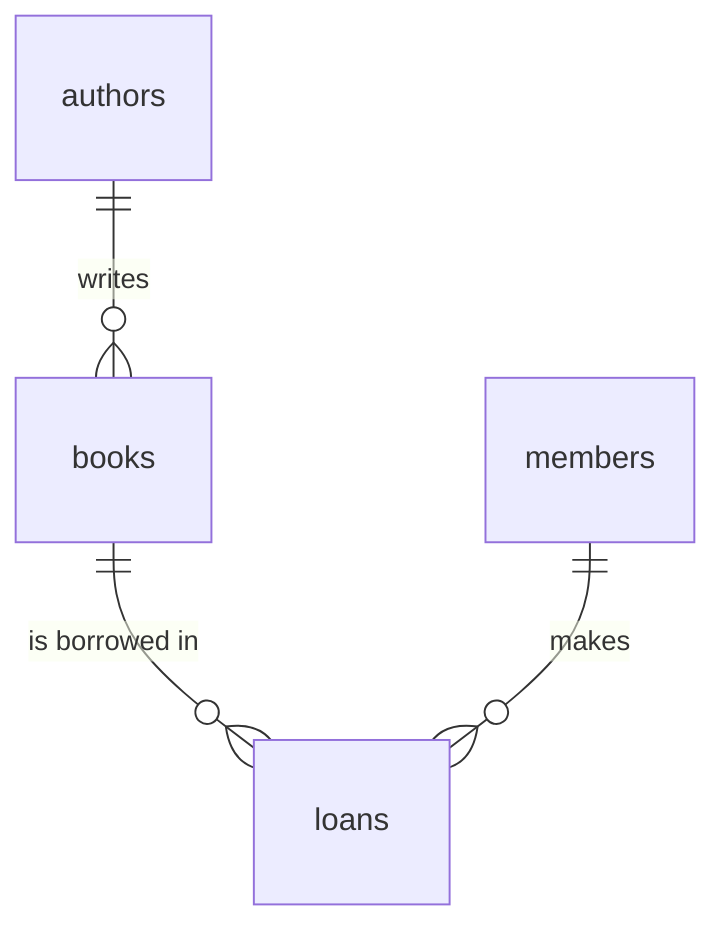

<div align="center">
  <h1> 30 Days Of SQL: Day 10 - Database Design & Normalization</h1>
</div>

[<< Day 9](../09_Day_Constraints_and_upsert/09_constraints_and_upsert.md) | [Review 1 >>](../10R_Review_Foundations/10R_review_foundations.md)

- [Day 10](#day-10)
  - [Why One Big Table Hurts](#why-one-big-table-hurts)
    - [Redundancy](#redundancy)
    - [The Three Anomalies](#the-three-anomalies)
  - [Entities and Relationships](#entities-and-relationships)
    - [One-to-Many](#one-to-many)
    - [One-to-One](#one-to-one)
    - [Many-to-Many and Junction Tables](#many-to-many-and-junction-tables)
  - [Normalization](#normalization)
    - [First Normal Form (1NF)](#first-normal-form-1nf)
    - [Second Normal Form (2NF)](#second-normal-form-2nf)
    - [Third Normal Form (3NF)](#third-normal-form-3nf)
    - [The Result](#the-result)
  - [Drawing the Design: ER Diagrams](#drawing-the-design-er-diagrams)
  - [When Not to Normalize](#when-not-to-normalize)
  - [Migrating Data into a New Design](#migrating-data-into-a-new-design)
  - [ Exercises: Day 10](#exercises-day-10)
    - [Exercises: Level 1](#exercises-level-1)
    - [Exercises: Level 2](#exercises-level-2)
    - [Exercises: Level 3](#exercises-level-3)

# Day 10

> **Before you migrate (Level 2):** the migration rebuilds your real `books` table, and [Review 1](../10R_Review_Foundations/10R_review_foundations.md) needs the *old* flat version. First make a backup: copy `00_practice/library.db` to `00_practice/library_flat.db` (copy the file in your file manager, or run `import shutil; shutil.copy('00_practice/library.db', '00_practice/library_flat.db')`).

You now know how to create tables, fill them, query them and protect them. Today is about the question that comes *before* all of that: **what tables should I have?**
Good design makes queries simple and data trustworthy. Bad design makes everything painful, and it is hard to fix once the data is in.

## Why One Big Table Hurts

The temptation, especially coming from spreadsheets, is to put everything in one table. Here is an online shop's orders as one flat table:

```py
import sqlite3
from helpers import show

conn = sqlite3.connect(':memory:')
conn.execute('''
    CREATE TABLE orders_flat (
        order_id INTEGER, customer TEXT, email TEXT, city TEXT,
        product TEXT, price_cents INTEGER, qty INTEGER
    )
''')
conn.executemany('INSERT INTO orders_flat VALUES (?, ?, ?, ?, ?, ?, ?)', [
    (1, 'Ana', 'ana@x.com', 'Toronto', 'Pen',      150, 2),
    (1, 'Ana', 'ana@x.com', 'Toronto', 'Notebook', 400, 1),
    (2, 'Ben', 'ben@x.com', 'London',  'Pen',      150, 5),
    (3, 'Ana', 'ana@x.com', 'Toronto', 'Stapler',  900, 1),
])
show(conn.execute('SELECT * FROM orders_flat'))
```

```sh
order_id  customer  email      city     product   price_cents  qty
--------  --------  ---------  -------  --------  -----------  ---
1         Ana       ana@x.com  Toronto  Pen       150          2
1         Ana       ana@x.com  Toronto  Notebook  400          1
2         Ben       ben@x.com  London   Pen       150          5
3         Ana       ana@x.com  Toronto  Stapler   900          1
(4 rows)
```

### Redundancy

Ana's email and city are written **three times**, and the price of a pen twice. Repeating facts wastes space, but the real damage is that the copies can disagree.

### The Three Anomalies

Redundancy causes three classic problems, called **anomalies**:

- **Update anomaly.** Ana moves to Ottawa. You must change every one of her rows. Miss one, and the database now claims she lives in two cities:

  ```py
  conn.execute("UPDATE orders_flat SET city = 'Ottawa' WHERE order_id IN (1, 3) AND product <> 'Notebook'")   # oops, missed a row
  show(conn.execute('SELECT DISTINCT customer, city FROM orders_flat ORDER BY customer, city'))
  ```

  ```sh
  customer  city
  --------  -------
  Ana       Ottawa
  Ana       Toronto
  Ben       London
  (3 rows)
  ```

- **Insert anomaly.** You cannot record a new product, or a customer who has not ordered yet, because every row needs an `order_id`. The facts are stuck inside the orders.
- **Delete anomaly.** If Ben cancels order 2 and you delete that row, you also lose the only record that Ben (and his email) existed.

The cure is to give each kind of fact **its own table**, stored once.

## Entities and Relationships

Start by listing the **entities**: the real-world things your data is about. For the shop: customers, products, orders. Each becomes a table, with one row per thing. Then describe how
the entities **relate** to each other. There are three kinds.

### One-to-Many

One row in table A can match many rows in table B, but each B row belongs to just one A row.

- One customer places many orders. Each order belongs to one customer.
- One author writes many books (in our library, each book has one author).

This is by far the most common. It is implemented with a **foreign key in the "many" side** pointing at the "one" side: `orders.customer_id` references `customers.id`.

### One-to-One

Each row in A matches at most one row in B, and the other way round. A person and their passport. It is rare, and often it is better to put both in one table. It is used to split off big or sensitive columns,
and the foreign key is also made `UNIQUE`.

### Many-to-Many and Junction Tables

Many rows of A relate to many rows of B. A student takes many courses, and a course has many students. A book is borrowed by many members over time, and a member borrows many books.

A foreign key column cannot hold "many" values, and we agreed not to pack lists into cells. The solution is a third table, a **junction table** (also called a link or bridge table), with one row per *pairing*
and two foreign keys. Usually it also carries facts about the pairing itself.

```sql
CREATE TABLE enrollments (
    student_id INTEGER NOT NULL REFERENCES students (id),
    course_id  INTEGER NOT NULL REFERENCES courses (id),
    grade      TEXT,                              -- a fact about the pairing
    PRIMARY KEY (student_id, course_id)           -- each pairing at most once
);
```

In the library, `loans` is the junction between `books` and `members`, and its extra facts are the dates. In the shop, `order_items` is the junction between `orders` and `products`, with the quantity.

## Normalization

**Normalization** is the process of restructuring tables to remove redundancy. It is described in steps called normal forms. Three are enough for nearly all work.

### First Normal Form (1NF)

*Every cell holds a single value, and there are no repeating groups.*

A table breaks 1NF if a cell holds a list (`'Pen, Notebook'`), or if it has numbered columns for repeating things (`product1`, `product2`, `product3`). Both make it impossible to query properly: how would you count
the orders that contain a pen? The fix is **one row per item**, which our flat table already has.

### Second Normal Form (2NF)

*Every non-key column depends on the **whole** key, not just part of it.*

In `orders_flat` the row is identified by the pair `(order_id, product)`. But `price_cents` depends only on `product` (a pen costs 150 whatever the order), and `customer`, `email` and `city` depend only on
`order_id`. These are **partial dependencies**: columns that belong to a smaller thing hiding inside the key. Move them out:

- facts about the product (name, price) go to `products`,
- facts about the order (who ordered it) go to `orders`,
- what remains in the middle table is what depends on the whole pair: the quantity.

### Third Normal Form (3NF)

*Non-key columns must depend on the key, and on nothing but the key.*

After splitting, `orders` would still hold `customer`, `email` and `city`. They depend on the *order's* key only through the customer: knowing who the customer is tells you the email and city. This is a **transitive dependency**
(order → customer → city). Move the customer facts into `customers`, and leave only a `customer_id` in `orders`.

A handy way to remember all three: *"Each column describes the key, the whole key, and nothing but the key."*

### The Result

```py
conn.executescript('''
    CREATE TABLE customers   (id INTEGER PRIMARY KEY, name TEXT NOT NULL, email TEXT NOT NULL UNIQUE, city TEXT);
    CREATE TABLE products    (id INTEGER PRIMARY KEY, name TEXT NOT NULL UNIQUE, price_cents INTEGER NOT NULL);
    CREATE TABLE orders      (id INTEGER PRIMARY KEY, customer_id INTEGER NOT NULL REFERENCES customers (id));
    CREATE TABLE order_items (
        order_id   INTEGER NOT NULL REFERENCES orders (id),
        product_id INTEGER NOT NULL REFERENCES products (id),
        qty        INTEGER NOT NULL CHECK (qty > 0),
        PRIMARY KEY (order_id, product_id)
    );
    INSERT INTO customers VALUES (1, 'Ana', 'ana@x.com', 'Toronto'), (2, 'Ben', 'ben@x.com', 'London');
    INSERT INTO products  VALUES (1, 'Pen', 150), (2, 'Notebook', 400), (3, 'Stapler', 900);
    INSERT INTO orders    VALUES (1, 1), (2, 2), (3, 1);
    INSERT INTO order_items VALUES (1, 1, 2), (1, 2, 1), (2, 1, 5), (3, 3, 1);
''')
```

Every fact now lives in exactly one place. Ana moves with a single, safe statement:

```py
cur = conn.execute("UPDATE customers SET city = 'Ottawa' WHERE name = 'Ana'")
print(cur.rowcount)      # 1
```

You can add a product nobody has ordered, or a customer with no orders, and deleting an order does not erase a customer. All three anomalies are gone. The price is that getting the old flat view back now requires **joining**
these tables, which is exactly what Days 11 and 12 teach. The `shop.db` database you will meet next is this design, grown larger.

## Drawing the Design: ER Diagrams

An **entity-relationship (ER) diagram** shows tables as boxes and relationships as lines. A crow's foot (`o{`) marks the "many" end. Here is our library after today's work, in text:

```
 authors ||──o{ books ||──o{ loans }o──|| members

 authors  (id PK, name)
 books    (id PK, title, author_id FK → authors, year, pages, genre, price_cents, rating)
 members  (id PK, name, email, joined_on)
 loans    (id PK, book_id FK → books, member_id FK → members, loaned_on, due_on, returned_on)
```

and the same thing as a Mermaid diagram, which GitHub and many editors draw as a picture:

````

````

Read `authors ||--o{ books` as "one author, zero or many books". Sketching the diagram before writing `CREATE TABLE` is the best habit in database design.

## When Not to Normalize

Normalization is right for databases that **change** a lot (shops, apps, bookkeeping), where correctness matters most. For **analysis**, where the data is loaded once and then only read, people often do the
opposite and **denormalize** on purpose: they join everything into one wide table, so queries are simple and scans are fast. A data warehouse's "flat" tables are exactly the `orders_flat` we just took apart, and
that is fine, because nobody updates a single customer's city in them. DuckDB (Day 23 on) is built for that world, and you will happily query wide tables there. The skill is knowing which job you are doing.

## Migrating Data into a New Design

Real databases rarely start from a perfect design. You usually have data already, and you reshape it. You have the tools: `CREATE TABLE`, `INSERT INTO ... SELECT` (Day 9), `UPDATE ... FROM` (Day 8) and the table rebuild. The pattern for pulling a repeating text
column out into its own table, using the library's `author` column as the example, is:

1. Create the new table and fill it with the **distinct** values:

   ```sql
   CREATE TABLE authors (id INTEGER PRIMARY KEY, name TEXT NOT NULL UNIQUE) STRICT;
   INSERT INTO authors (name) SELECT DISTINCT author FROM books ORDER BY author;
   ```

2. Add a foreign key column to the old table, and fill it by matching on the text:

   ```sql
   ALTER TABLE books ADD COLUMN author_id INTEGER REFERENCES authors (id);
   UPDATE books SET author_id = authors.id FROM authors WHERE authors.name = books.author;
   ```

3. Check that no row was missed (`WHERE author_id IS NULL` should find nothing), then rebuild the table without the old text column and with the new constraints.

That is your exercise today.  Design is a skill you build by doing. Now do some exercises.

## Exercises: Day 10

### Exercises: Level 1

These are thinking exercises, with a few small queries. Write your answers as comments in `00_practice/day_10.py`.

1. In `orders_flat`, show each of the three anomalies by running code: make an update that leaves Ana in two cities; explain why you can't add a new product on its own; and explain what you lose by deleting order 2.
   Print the result of the first one.

   ```sh
   customer  city
   --------  -------
   Ana       Ottawa
   Ana       Toronto
   Ben       London
   (3 rows)
   ```

2. Name the relationship (one-to-one, one-to-many or many-to-many) in each case and say how you would implement it:
   a. a country and its capital city,
   b. a customer and their orders,
   c. students and the clubs they join,
   d. a library book and its copies on the shelf,
   e. a user and their single profile picture record.
3. In your own words, explain what *First Normal Form* means. Give one table that breaks it and show how to fix it.
4. This table breaks a normal form. Which one, and why? How would you split it?

   ```
   courses (course_id, student_id, student_name, grade)      primary key: (course_id, student_id)
   ```

5. This one breaks a different normal form. Which one, and why? How would you split it?

   ```
   employees (id, name, dept_id, dept_name, dept_floor)      primary key: id
   ```

6. Why can a many-to-many relationship not be stored with a foreign key column on either table? What do you add instead?
7. Draw (as text or Mermaid) the ER diagram for the orders design from the lesson: `customers`, `orders`, `order_items`, `products`.
8. In the final design, which two tables does the `loans` junction table connect, and which extra facts does it store?

### Exercises: Level 2

**Migrate your library.** Your `books` table still has the author's name typed in on every row, so "Jane Austen" is stored twice and "Andy Weir" twice. Follow the three-step migration at the end of the lesson to reach this design. Use a connection that runs
`PRAGMA foreign_keys = ON` right after connecting.

```
authors (id PK, name UNIQUE NOT NULL)
books   (id PK, title, author_id FK → authors, year, pages, genre, price_cents, rating, title_length [generated])
members (id PK, name, email UNIQUE, joined_on)
loans   (id PK, book_id FK → books, member_id FK → members, loaned_on, due_on, returned_on)
```

1. Create `authors` and fill it with the distinct author names (`INSERT INTO ... SELECT DISTINCT ... ORDER BY author`). Print how many authors there are (it should be 10).
2. Add `author_id` to `books` and fill it with `UPDATE ... FROM`. Check that no book has a NULL `author_id`.
3. Rebuild `books` **without** the `author` column. Keep every rule from Day 9 (CHECKs, `STRICT`, the generated `title_length`), make `author_id` `NOT NULL`, and replace `UNIQUE (title, author)` with `UNIQUE (title, author_id)`.
   Copy the 12 books across with `INSERT INTO ... SELECT`, drop the old table and rename the new one.
4. Create `members` and `loans` as shown, then insert the following data with `executemany`.

   ```py
   members = [
       ('Alice Nguyen', 'alice@example.com', '2024-01-15'),
       ('Bruno Silva',  'bruno@example.com', '2024-02-20'),
       ('Chloe Martin', 'chloe@example.com', '2024-03-05'),
       ('Dev Patel',    'dev@example.com',   '2024-06-18'),
       ('Elena Rossi',  'elena@example.com', '2024-09-02'),
   ]
   # (book_id, member_id, loaned_on, due_on, returned_on)       None means not returned yet
   loans = [
       (1, 1, '2025-01-10', '2025-01-24', '2025-01-20'),
       (3, 1, '2025-01-25', '2025-02-08', '2025-02-05'),
       (7, 2, '2025-02-01', '2025-02-15', '2025-02-14'),
       (9, 2, '2025-02-20', '2025-03-06', None),
       (12, 3, '2025-02-03', '2025-02-17', '2025-02-25'),
       (2, 3, '2025-03-01', '2025-03-15', None),
       (5, 4, '2025-03-05', '2025-03-19', None),
       (1, 4, '2025-03-08', '2025-03-22', None),
       (10, 1, '2025-03-10', '2025-03-24', None),
       (3, 2, '2025-03-12', '2025-03-26', None),
   ]
   ```

   Verify the sizes and run `PRAGMA foreign_key_check` (it should return an empty list).

   ```sh
   authors 10
   books 12
   members 5
   loans 10
   id  title                 author_id
   --  --------------------  ---------
   1   Dune                  4
   2   Neuromancer           10
   3   The Hobbit            6
   4   The Name of the Wind  8
   (4 rows)
   []
   ```

5. Prove the foreign keys work: try to insert a loan for `book_id = 99` and print the error.

   ```sh
   FOREIGN KEY constraint failed
   ```

> **Keep this library!** It is the starting point for the next 20 days: the join lessons, views, triggers and your final project all use these four tables. If your migration went wrong, you can re-run your steps from the Day 9 state, or compare with `solutions/day_10.py`.

### Exercises: Level 3

Time to deal with the `languages` list we ignored on Day 3. In `countries_data.json`, each country has a list of spoken languages: a list inside a cell, which is exactly what breaks 1NF. A country speaks many languages, and a language is spoken in many
countries: a **many-to-many** relationship.

Work in `00_practice/datasets.db`, and run `PRAGMA foreign_keys = ON` right after connecting.

1. Give `countries` an `id` and some rules by rebuilding it: `id INTEGER PRIMARY KEY`, `name` unique and required, `population` required and never negative. Copy the 250 countries across with `INSERT INTO ... SELECT` (leave out `id`, SQLite numbers the rows), drop the old table and rename.
2. Create `languages (id INTEGER PRIMARY KEY, name TEXT NOT NULL UNIQUE)` and the junction table `country_languages (country_id, language_id)` with both foreign keys and a composite primary key.
3. Read `data/countries_data.json`. For every country and every language it speaks, make sure the language exists (`INSERT OR IGNORE`), find its id, and insert the pairing. Verify the sizes. (The ids you get for languages depend on the order they are first met. Don't rely on them.)

   ```sh
   countries 250
   languages 112
   country_languages 368
   ```

   Also check that every country appears in the junction table at least once, and that `PRAGMA foreign_key_check` is empty.

   ```sh
   (0,)    # countries without any language
   []
   ```

Tomorrow you will finally query across these tables. A question like "which are the ten most spoken languages?", which takes loops and dictionaries in plain Python, becomes a single query.

CONGRATULATIONS !

[<< Day 9](../09_Day_Constraints_and_upsert/09_constraints_and_upsert.md) | [Review 1 >>](../10R_Review_Foundations/10R_review_foundations.md)
